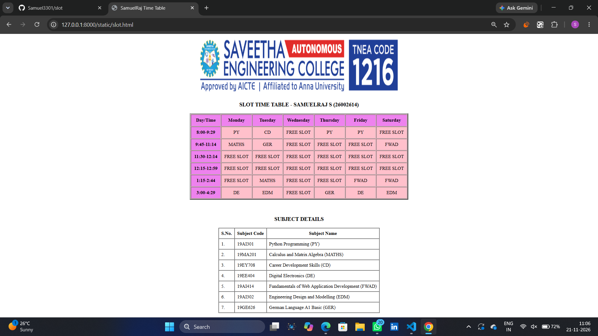

# Ex04 Time Table
## Date:21/11/2026

## AIM
To write a html webpage page to display your slot timetable.

## ALGORITHM
### STEP 1
Create a Django-admin Interface.

### STEP 2
Create an App inside the Django project.

### STEP 2
Create a static folder uder the created App and insert HTML code.

### STEP 3
Create a simple table using ```<table>``` tag in html with the relevant attributes.

### STEP 4
Add rows using ```<tr>``` tag.

### STEP 5
Add your course schedule using ```<td>``` tag.

### STEP 6
Execute the program using runserver command.

## PROGRAM
```
<!DOCTYPE html>
<html>
<head>
    <title>SamuelRaj Time Table</title>
</head>
<body>

<center>

<h3>SLOT TIME TABLE - SAMUELRAJ S (26002614)</h3>

<table border="4" cellpadding="10" cellspacing="2" bgcolor="pink">
  
<tr bgcolor="violet">
    <th>Day/Time</th>
    <th>Monday</th>
    <th>Tuesday</th>
    <th>Wednesday</th>
    <th>Thursday</th>
    <th>Friday</th>
    <th>Saturday</th>
</tr>

<tr>
    <th bgcolor="violet">8:00-9:29</th>
    <td align="center">PY</td>
    <td align="center">CD</td>
    <td align="center">FREE SLOT</td>
    <td align="center">PY</td>
    <td align="center">PY</td>
    <td align="center">FREE SLOT</td>
</tr>

<tr>
    <th bgcolor="violet">9:45-11:14</th>
    <td align="center">MATHS</td>
    <td align="center">GER</td>
    <td align="center">FREE SLOT</td>
    <td align="center">FREE SLOT</td>
    <td align="center">FREE SLOT</td>
    <td align="center">FWAD</td>
</tr>

<tr>
    <th bgcolor="violet">11:30-12:14</th>
    <td align="center">FREE SLOT</td>
    <td align="center">FREE SLOT</td>
    <td align="center">FREE SLOT</td>
    <td align="center">FREE SLOT</td>
    <td align="center">FREE SLOT</td>
    <td align="center">FREE SLOT</td>
</tr>

<tr>
    <th bgcolor="violet">12:15-12:59</th>
    <td align="center">FREE SLOT</td>
    <td align="center">FREE SLOT</td>
    <td align="center">FREE SLOT</td>
    <td align="center">FREE SLOT</td>
    <td align="center">FREE SLOT</td>
    <td align="center">FREE SLOT</td>
</tr>

<tr>
    <th bgcolor="violet">1:15-2:44</th>
    <td align="center">FREE SLOT</td>
    <td align="center">MATHS</td>
    <td align="center">FREE SLOT</td>
    <td align="center">FREE SLOT</td>
    <td align="center">FWAD</td>
    <td align="center">FWAD</td>
</tr>

<tr>
    <th bgcolor="violet">3:00-4:29</th>
    <td align="center">DE</td>
    <td align="center">EDM</td>
    <td align="center">FREE SLOT</td>
    <td align="center">GER</td>
    <td align="center">DE</td>
    <td align="center">EDM</td>
</tr>

</table>

<br><br>

<h3>SUBJECT DETAILS</h3>

<table border="2" cellpadding="8" cellspacing="1">

<tr>
    <th>S.No.</th>
    <th>Subject Code</th>
    <th>Subject Name</th>
</tr>

<tr>
    <td>1.</td>
    <td>19AI301</td>
    <td>Python Programming (PY)</td>
</tr>

<tr>
    <td>2.</td>
    <td>19MA201</td>
    <td>Calculus and Matrix Algebra (MATHS)</td>
</tr>

<tr>
    <td>3.</td>
    <td>19EY708</td>
    <td>Career Development Skills (CD)</td>
</tr>

<tr>
    <td>4.</td>
    <td>19EE404</td>
    <td>Digital Electronics (DE)</td>
</tr>

<tr>
    <td>5.</td>
    <td>19AI414</td>
    <td>Fundamentals of Web Application Development (FWAD)</td>
</tr>

<tr>
    <td>6.</td>
    <td>19AI302</td>
    <td>Engineering Design and Modelling (EDM)</td>
</tr>

<tr>
    <td>7.</td>
    <td>19GE626</td>
    <td>German Language A1 Basic (GER)</td>
</tr>

</table>

</center>

</body>
</html>
```

## OUTPUT


## RESULT
The program for creating slot timetable using basic HTML tags is executed successfully.
